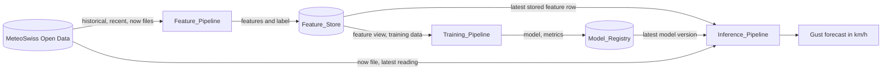

# Wind Gust Forecasting at Bern / Zollikofen (MLOps project)

## Topic

This project is a small Feature / Training / Inference (FTI) machine learning system for the MLOps course. It forecasts wind gusts at the MeteoSwiss station Bern / Zollikofen. It uses Hopsworks (project `gust_prediction`) as Feature Store and Model Registry and runs locally..

## Forecast task

The task is regression. Given the weather of the last hours and the latest live reading, the model predicts how strong the strongest gust will be in the next hour. The result is a number in km/h.

## Label and horizon

- Label: `gust_max_next_1h`. It is the maximum of the one-second gust peak (`fu3010z1`, km/h) over the six readings at t + 10, 20, 30, 40, 50 and 60 minutes. The reading at t itself is not part of the label.
- Forecast horizon: 1 hour (6 readings of 10 minutes each).
- If one of the six future readings is missing or not yet available, the label is null. These rows are kept as unlabeled rows in the Feature Store and get their label later, when the data exists. Values are never imputed.

## Data source

- Source: MeteoSwiss (MeteoSwiss Open Data, automatic weather stations SMN).
- Station: BER (Bern / Zollikofen), 10-minute granularity.
- Base URL: `https://data.geo.admin.ch/ch.meteoschweiz.ogd-smn/ber/`
- File types used:
  - Historical file: data until 31 December of last year, split by decade (`ogd-smn_ber_t_historical_2000-2009.csv`, `..._2010-2019.csv`, `..._2020-2029.csv`). Used for backfill.
  - Recent file `ogd-smn_ber_t_recent.csv`: 1 January of this year until yesterday. Used for backfill and incremental runs.
  - Now_File `ogd-smn_ber_t_now.csv`: from yesterday 12 UTC until the latest reading, updated every 10 minutes. Used for incremental runs and for inference.
- Training years: 2023, 2024, 2025 (historical file) plus the current year (recent file).
- Time zone (verified in the [MeteoSwiss documentation](https://opendatadocs.meteoswiss.ch/general/download)): "All reference time stamps at MeteoSwiss are in UTC". For the 10-minute granularity the timestamp marks the end of the 10-minute interval. All timestamps in this project are UTC.
- The CSV files use `;` as delimiter, empty fields are missing values, and `reference_timestamp` has the format `dd.mm.yyyy HH:MM`.

## Architecture



The Feature_Store holds the feature group `bern_wind_features` (v1) and the feature view `bern_wind_gust_fv` (v1). The Model_Registry holds the model `bern_wind_gust_model`.

Code layout:

- `src/common/`: shared code (constants in `config.py`, feature logic, MeteoSwiss access, Hopsworks access, metrics, logging)
- `src/feature_pipeline/`, `src/training_pipeline/`, `src/inference_pipeline/`: one folder per pipeline
- `src/tests/`: tests that need no network and no credentials

## Features

All features are computed on the 10-minute grid. A window is the trailing interval (t - window, t], including the reading at t. Window lengths: 1 h = 6 readings, 3 h = 18 readings, 6 h = 36 readings. If a window is not complete or has a missing value, the feature is missing and the row is not stored.

Aggregated features (stored in the Feature Store, same function for training and inference):

| Feature | Source column | Window |
|---|---|---|
| `gust_max_1h` | `fu3010z1` (max) | 1 hour |
| `gust_max_3h` | `fu3010z1` (max) | 3 hours |
| `gust_max_6h` | `fu3010z1` (max) | 6 hours |
| `wind_mean_1h` | `fu3010z0` (mean) | 1 hour |
| `wind_mean_3h` | `fu3010z0` (mean) | 3 hours |
| `wind_mean_6h` | `fu3010z0` (mean) | 6 hours |
| `pressure_change_3h` | `pp0qffs0` (value at t minus value 3 h before) | 3 hours |

Realtime features (taken from the latest Now_File reading at inference time):

| Feature | Source column | Window |
|---|---|---|
| `gust_now` | `fu3010z1` | none (reading at t, 10 minutes) |
| `wind_speed_now` | `fu3010z0` | none (reading at t, 10 minutes) |
| `wind_dir_sin` | `dkl010z0` (sine of direction in degrees) | none (reading at t, 10 minutes) |
| `wind_dir_cos` | `dkl010z0` (cosine of direction in degrees) | none (reading at t, 10 minutes) |
| `temp_now` | `tre200s0` | none (reading at t, 10 minutes) |
| `humidity_now` | `ure200s0` | none (reading at t, 10 minutes) |
| `pressure_now` | `pp0qffs0` | none (reading at t, 10 minutes) |
| `precip_now` | `rre150z0` | none (reading at t, 10 minutes) |
| `radiation_now` | `gre000z0` | none (reading at t, 10 minutes) |

The feature group stores the realtime columns too (the values of the reading itself), so training and serving use the same definition. At inference the stored aggregated values are combined with the live realtime values.

## Model, split and metrics

Model: scikit-learn `HistGradientBoostingRegressor` with these hyperparameters:

| Hyperparameter | Value |
|---|---|
| `max_iter` | 300 |
| `learning_rate` | 0.05 |
| `max_depth` | 6 |
| `min_samples_leaf` | 50 |
| `early_stopping` | False |
| `random_state` | 42 |

It handles missing values natively and is deterministic without early stopping.

Train-test split: a time split, no shuffling. Labeled rows are sorted by `reference_timestamp`. The earliest 80% are the training set and the latest 20% are the test set. Unlabeled rows are dropped before the split.

Result of the recorded run (202,469 rows in the feature group, 6 unlabeled rows dropped, 202,463 labeled):

| Set | Rows | Date range (UTC) |
|---|---|---|
| Train | 161,970 | 2023-01-01 05:50 to 2026-01-30 00:40 |
| Test | 40,493 | 2026-01-30 00:50 to 2026-11-07 11:30 |

Metrics on the test set, in km/h, rounded to 2 decimals (n = number of test rows, y = true label, ŷ = prediction):

- RMSE = sqrt( (1/n) · Σ (y − ŷ)² ). Recorded value: 4.43 km/h.
- MAE = (1/n) · Σ |y − ŷ|. Recorded value: 2.94 km/h.
- Persistence baseline RMSE: same RMSE formula, but ŷ is the current gust peak `gust_now` of the reference time. Recorded value: 5.79 km/h.

The model RMSE is lower than the baseline RMSE. No minimum performance is required for a pipeline run to succeed.

## Setup

- Python 3.12 (the project requires `==3.12.*`).
- Dependency tool: [uv](https://docs.astral.sh/uv/). All dependencies are pinned with exact versions and locked in `uv.lock`.
- You need a Hopsworks account with a project named `gust_prediction` and an API key.

Steps, in order:

1. Install the dependencies from the lock file:

   ```bash
   uv sync --frozen
   ```

2. Create the environment file. Only `src/.env.example` is committed. `src/.env` is git-ignored and must be created by you:

   ```bash
   cp src/.env.example src/.env
   ```

3. Open `src/.env` and fill in these variables:
   - `HOPSWORKS_API_KEY`: your Hopsworks API key (empty in the example file)
   - `HOPSWORKS_PROJECT_NAME`: the Hopsworks project name (`gust_prediction` in the example file)

   Never commit `src/.env`. If a variable is missing or empty, a pipeline stops with a non-zero exit code and names the variable, before any call to Hopsworks.

## Run the pipelines

Run the commands from the repository root, in this order.

```bash
uv run python -m src.feature_pipeline.main backfill
```

Downloads the historical files for 2023 to 2025 and the recent file, computes features and labels, and writes all rows to the feature group (the recorded run inserted 202,393 rows from 2023-01-01T05:50Z to 2026-11-06T23:50Z).

```bash
uv run python -m src.feature_pipeline.main incremental
```

Downloads the recent and now files and upserts the rows of the last 2 days, including the newest reading with a null label, so rows are replaced and not duplicated.

```bash
uv run python -m src.training_pipeline.main
```

Reads the feature view, makes the time split, trains the model, logs RMSE, MAE and baseline RMSE, and registers a new model version in the Model Registry.

```bash
uv run python -m src.inference_pipeline.main
```

Loads the newest stored feature row, the latest live reading and the newest model version, and prints exactly one line, for example `BER 2026-11-07T12:40:00+00:00 forecast_max_gust_next_1h=9.7 km/h`.

```bash
uv run pytest
```

Runs the tests (features, labels, training-serving consistency) without network and without Hopsworks credentials and reports passed and failed tests.

## Known limitations and reflection

Limitations:

- Limited Now_File history: the Now_File only covers the time from yesterday 12 UTC until the latest reading. Inference therefore relies on the aggregated features stored by the incremental feature pipeline, not on a long live history.
- Single station: only BER is used. The model is not tested for other locations.
- Latency: a reading appears in the Now_File with a delay of at least one 10-minute update. The forecast is based on the newest available reading, which can be about 10 minutes old.
- Stored aggregates can lag the live reading by the time since the last incremental run. The inference pipeline logs a warning when the stored row is older than 24 hours.
- Incremental trailing window: incremental mode only writes the last 2 days. If the previous run is older than 2 days, the gap is not repaired. Run `backfill` to repair it.
- Year boundary: in the first hours after 1 January, the recent file has fewer than 37 readings, so no complete 6-hour window exists and no rows are stored. The last hour of 31 December may keep a null label if no run happened before the file switch, because incremental mode does not read the historical file.
- Partial model upload after timeout: the model upload is limited to 120 seconds. If it times out, the client cannot roll back, so a partial model version may remain in the Model Registry. Check the registry manually and delete such a version.
- Registering the model with `model.save` moves the files out of `src/training_pipeline/artifacts/`, so that folder does not keep a copy of the model after a successful run.
- Model performance was not tuned. Hyperparameters were set once.

Difficulties and how they were solved:

- The `hopsworks` package needed the `[python]` extra (it brings the delta library) to write the feature group. The dependency is now `hopsworks[python]`.
- Hopsworks returns the key and event-time columns with a prefixed name when they are not selected as features. The helper `_strip_key_prefix` restores the names `station` and `reference_timestamp`.
- The Hopsworks client prints progress to stdout. The inference pipeline redirects it to stderr so that stdout has exactly one output line.

## Out of scope (version 1)

The optional extension stages are not implemented in version 1:

- Data validation with Great Expectations
- Transformation functions
- Spine groups
- Model deployment
- Containerization
- Web application
- Ground-truth feedback
- Multiple feature groups with joins
- Hopsworks dataset splits

Source: MeteoSwiss.
